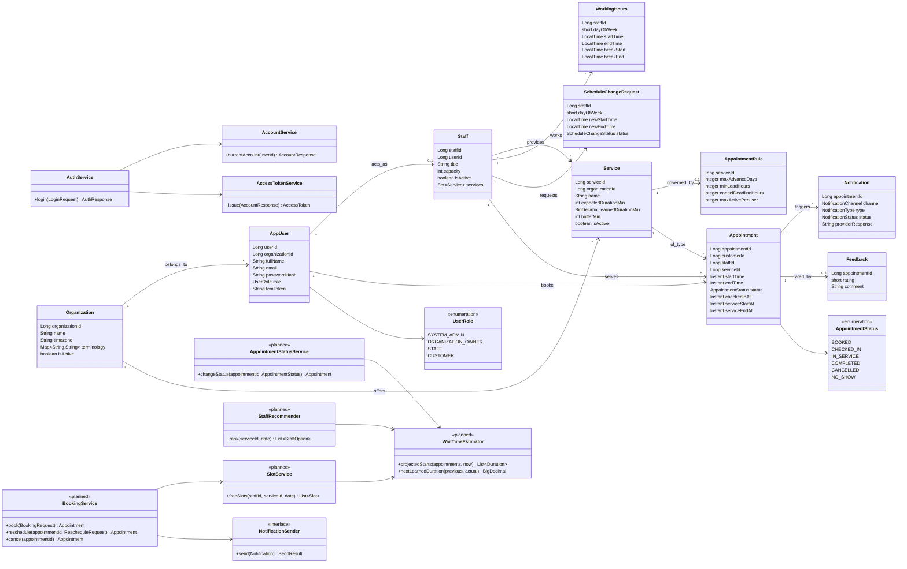
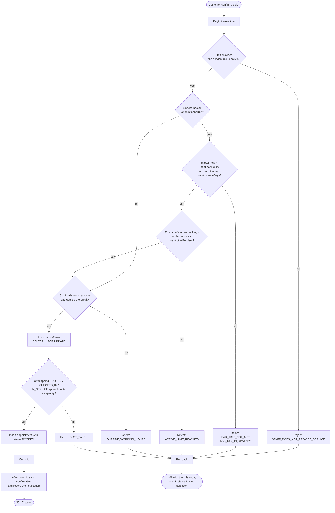
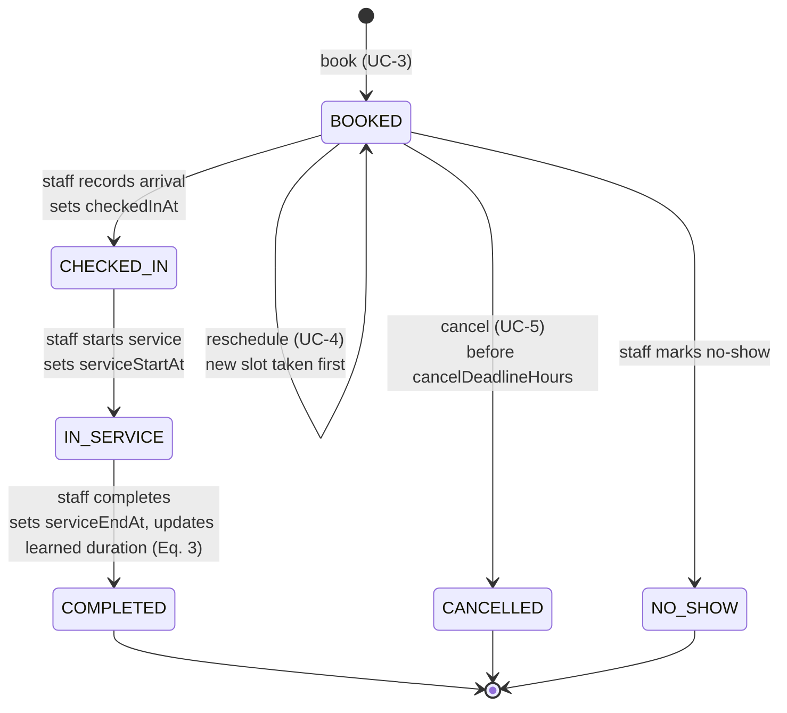
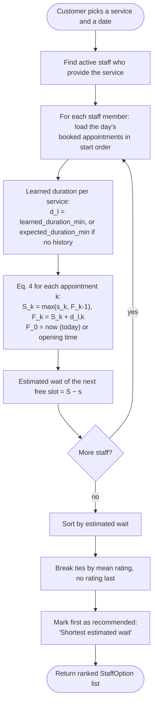
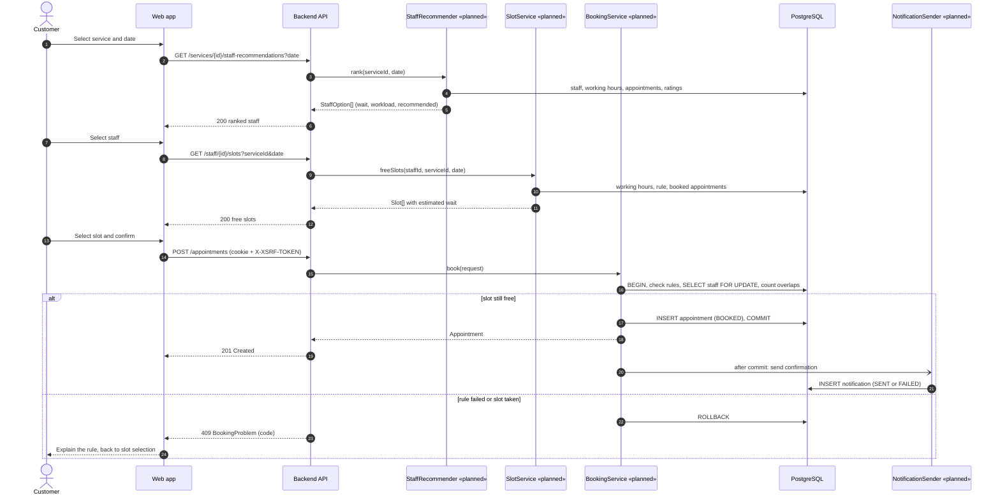
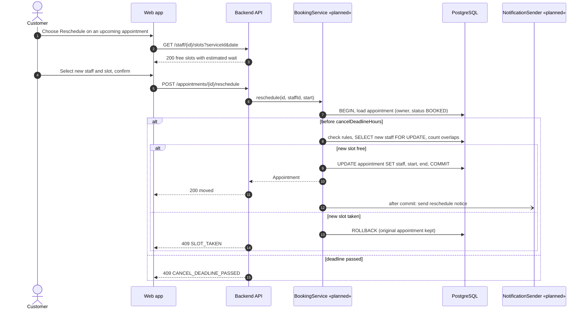
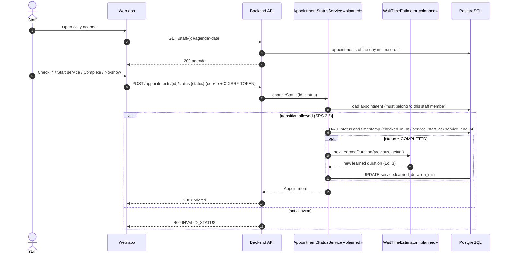
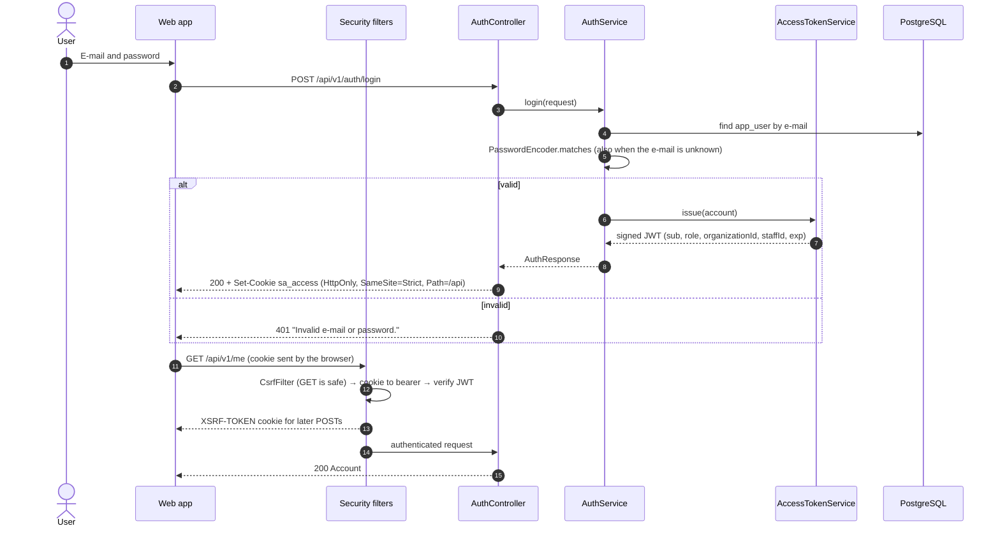
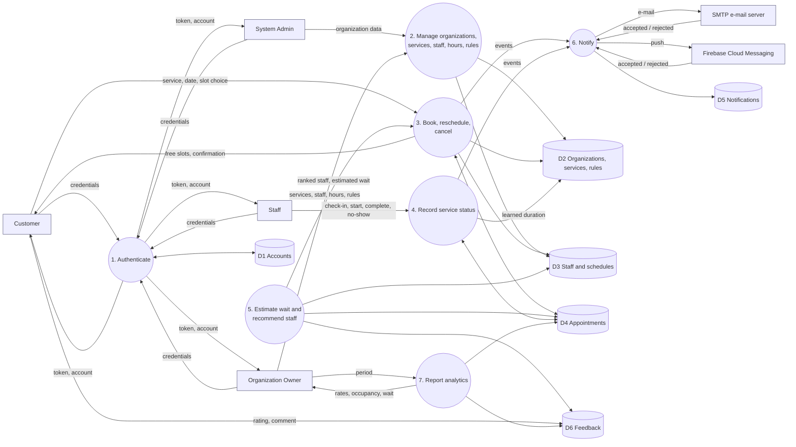
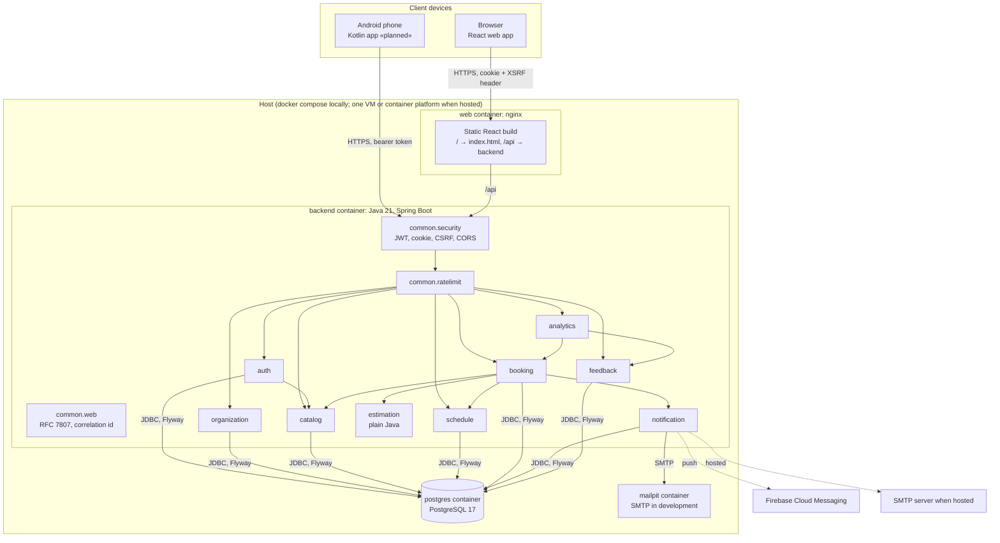

# Design flows for the SDD

Diagram sources for the SDD (IEEE 1016, 4+1 views) in Mermaid, written from the code and the contract. Paste a block into <https://mermaid.live> (or any Mermaid renderer) to export it as an image. Each diagram follows the SDD template's limits and comes with its design rationale.

**Legend.** Classes and calls marked `«planned»` belong to handoff tasks B4–B12 and are not implemented yet; everything else exists in the code (`backend/src/main/java/com/smartappointment/`). When a planned piece is built, update its diagram here in the same PR.

| SDD section | Diagram | Status |
|---|---|---|
| 3.1.1 Class diagram | [Logical view](#1-logical-view-class-diagram) | domain implemented; booking services planned |
| 3.2.1 Activity diagrams | [Booking validation](#21-activity-1-booking-validation-uc-3-step-6), [Status lifecycle](#22-activity-2-appointment-status-lifecycle-uc-8), [Waiting time and recommendation](#23-activity-3-waiting-time-estimate-and-staff-recommendation-uc-18-uc-19) | rules fixed by the SRS; code planned |
| 3.2.2 Sequence diagrams | [UC-3 Book](#31-sequence-1-uc-3-book-appointment), [UC-4 Reschedule](#32-sequence-2-uc-4-reschedule-appointment), [UC-8 Record status](#33-sequence-3-uc-8-record-service-status), [UC-2 Sign in](#34-supporting-sequence-uc-2-sign-in-implemented) | UC-2 implemented; others planned |
| 3.2.3 Data flow | [DFD level 0](#4-process-view-data-flow-diagram-level-0) | |
| 3.3 Development + physical | [Component and deployment](#5-development-and-physical-view-component-and-deployment-diagram) | implemented as in `docker-compose.yml` |

## 1. Logical view: class diagram

**Interpretation and design rationale**

- **Entities** map one-to-one to the eleven tables of SRS Table 9 (`staff_service` is the many-to-many between `Staff` and `Service`). Relationship names are the ones in the SRS ER diagram.
- **Feature packages own their entities.** Associations across features are held as ids (`Appointment.staffId`, not a `Staff` reference), so `booking`, `catalog` and `auth` stay independent; features cooperate only through services (`AuthService → AccountService → StaffLookupService`), which ArchUnit enforces.
- **Calculations are separate from persistence.** `WaitTimeEstimator` implements Eq. 3 and Eq. 4 as plain Java with no database or Spring dependency, so the recommendation can be unit-tested with the SRS examples.
- **External messaging sits behind `NotificationSender`,** so e-mail (SMTP) and push (FCM) can be swapped or mocked; a failed send is recorded in `Notification.status` and never rolls back the appointment.

## 2. Process view: activity diagrams

### 2.1 Activity 1: booking validation (UC-3 step 6)

**Design rationale.** The order checks cheap, request-level rules first and takes the lock only for the capacity check, so the lock is held for the shortest time. Counting and inserting under a row lock in one transaction is what guarantees SRS P2 ("capacity never exceeded under concurrent booking"); the rule codes are the `BookingProblem.code` values in the contract, so the client can tell the customer which rule failed (SRS U1). The confirmation is sent after commit so a mail failure cannot undo a booking.

### 2.2 Activity 2: appointment status lifecycle (UC-8)

**Design rationale.** The allowed transitions are exactly those in SRS 2.5; any other request is rejected with `INVALID_STATUS`. The server stamps each time itself so the recorded durations that feed Eq. 3 cannot be edited by clients. Final states are never deleted, which keeps the history needed for analytics (F10) and the no-show rate. The same transition table is used by the web prototype (`web/src/api/statusTransitions.ts`) to enable only valid buttons.

### 2.3 Activity 3: waiting-time estimate and staff recommendation (UC-18, UC-19)

**Design rationale.** The estimate uses only the schedule and recorded service times (SRS 1.4.4), so it can be recomputed on every request and is never stored. Learned durations come from Eq. 3 (EWMA, α = 0.2), which reacts to recent runs without being thrown off by one long appointment. Ranking by wait and then rating follows the SRS; the customer can still choose another staff member, and the reason is shown on screen.

## 3. Process view: sequence diagrams

Only the critical use cases are shown (SDD template); inclusions UC-18, UC-19 and UC-20 are part of UC-3 and UC-4.

### 3.1 Sequence 1: UC-3 Book appointment

| Use Case | Key Actors | Main Interactions |
|---|---|---|
| UC-3 Book Appointment (with UC-18, UC-19, UC-20) | Customer, Web app, Backend, PostgreSQL, SMTP | The customer sees staff ranked by estimated wait and free slots, confirms one, and the backend books it under a capacity lock and e-mails a confirmation. |

**Design rationale.** Recommendation, slots and booking are separate requests so each screen step stays fast (SRS P1 < 500 ms for reads) and the customer can change staff without re-booking. The booking re-checks everything in the transaction because the slot list may be stale by the time the customer confirms; that is the alternative course of UC-3 step 6. Notification is asynchronous after commit, matching SRS P3 and the rule that sending never undoes a booking.

### 3.2 Sequence 2: UC-4 Reschedule appointment

| Use Case | Key Actors | Main Interactions |
|---|---|---|
| UC-4 Reschedule Appointment (with UC-19, UC-20) | Customer, Web app, Backend, PostgreSQL, SMTP | The customer picks a new slot for an upcoming appointment; the backend takes the new slot before releasing the old one, in one transaction, and sends a notice. |

**Design rationale.** Moving the existing row instead of cancelling and re-creating keeps one appointment history and makes the operation atomic: the old slot is released only if the new one is taken (UC-4 post-condition). The deadline is checked before any lock so late requests fail fast. The same capacity check as booking prevents a reschedule from overbooking the new staff member.

### 3.3 Sequence 3: UC-8 Record service status

| Use Case | Key Actors | Main Interactions |
|---|---|---|
| UC-8 Record Service Status | Staff, Web app, Backend, PostgreSQL | The staff member records check-in, start and completion (or no-show); the backend stamps the times and, on completion, updates the learned service duration. |

**Design rationale.** Status changes go through one service with a transition table, so the web buttons, the API and the database check agree. The learned duration is updated in the same transaction as the completion, so the next waiting estimate (Activity 3) already uses it. Times are taken from the server clock, not the client, which keeps durations comparable across devices.

### 3.4 Supporting sequence: UC-2 Sign in (implemented)

| Use Case | Key Actors | Main Interactions |
|---|---|---|
| UC-2 Log In | User (any role), Web app, Backend, PostgreSQL | The user signs in with e-mail and password; the backend returns the account and sets an HttpOnly token cookie used by every later request. |

**Design rationale.** The session is the signed token, so the backend stays stateless (ADR-0008). The token sits in an HttpOnly cookie that scripts cannot read, and every state-changing request must also carry the CSRF header (ADR-0015). An unknown e-mail takes the same path as a wrong password so responses do not reveal which accounts exist.

## 4. Process view: data flow diagram (level 0)

**Design rationale.** The diagram shows the four roles and the two external messaging services from the SRS context diagram (Figure 1) as the only external entities. Appointments (D4) are the central store: booking writes them, status recording completes them, and both the estimate and analytics read them, which is why recorded service times are required (SRS 1.4.5).

## 5. Development and physical view: component and deployment diagram

- **Components follow the feature packages** (ADR-0001): each owns its entities, service and controller; cross-cutting concerns live in `common`. Dependencies point one way (no cycles, checked by ArchUnit), and `estimation` depends on nothing but Java.
- **Deployment is the same images everywhere** (ADR-0008): `web` (nginx serving the React build and proxying `/api`), `backend` (stateless, so more instances can run behind a load balancer), `postgres`, and `mailpit` in development replaced by a real SMTP server when hosted; configuration comes from environment variables.
- **Clients:** the browser uses the session cookie with CSRF protection through the same origin; the Android app calls the API directly with a bearer token (ADR-0015).
